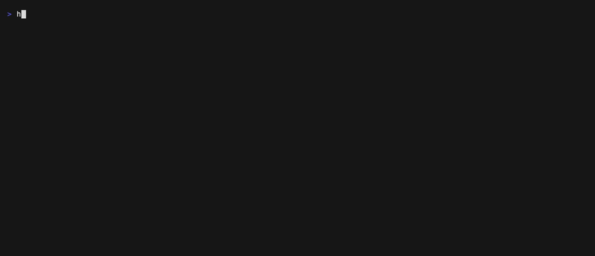

# Honest Server

Catch light servers that lie.

Honest Server checks Zcash light-wallet servers (lightwalletd and Zaino) against full blocks it fetches straight from Zcash peers, and shows any shielded note, nullifier or block a server leaves out, changes or serves late.

A shielded wallet can't see the chain itself. It only decrypts what its server sends, so a server that drops one note hides a payment, and the wallet has no way to notice.



**Live table:** https://honest-server.vercel.app

**Try it in 30 seconds** (needs Rust; nothing else):

```bash
cargo install --git https://github.com/kinnuworks/honest-server
honest-server check zec.rocks:443
honest-server check zec.rocks:443 --test-drop-note
```

The first command checks the server for real. The second takes the same real data, removes one shielded note and patches the tree sizes so the chain still adds up, then shows that Honest Server catches it.

`honest-server selftest zec.rocks:443` goes further: it makes every single change it can to the server's real blocks and counts how many the check catches. The live page shows the latest run. On Oct 28 2026 at 17:51 UTC, on 24 mainnet blocks, it tried 1,893 changes across Sapling, Orchard and Ironwood (Zcash's three shielded pools) and caught all 1,893.

## Protect your wallet

`honest-server proxy` runs a light-wallet server on your own machine. Point your wallet's custom server setting at it (the wallet has to accept a plain local address such as `http://127.0.0.1:9067`):

```bash
honest-server proxy zec.rocks:443
```

It forwards every call to the real server over Tor whenever a Tor proxy is running on `127.0.0.1:9050` (or the one you name with `--tor`), so the server sees a Tor exit instead of your IP. If no Tor is running it says so and connects directly; `--direct` skips Tor on purpose. Before it hands your wallet any block from the last 100, it checks the block against the verified blocks from Zcash peers, in batches of 16. A block that doesn't match is refused, and your wallet gets an error naming the block, the transaction and the field, instead of silently missing a payment. `--strict` also refuses blocks that two peers couldn't confirm. `--test-drop-note` removes one real note before the check, so you can see a refusal:

```
REFUSED Honest Server refused block 3533812 from the server: transaction 1df0be5bbff4d19c...: Ironwood actions: block has 2, server sent 1
```

Older blocks, outside the window, pass through unchecked unless you ask for spot checks: `--sample 50` checks about one in 50, chosen by a secret the proxy picks at start-up, so the server can't tell which of its blocks will be checked. It's off by default because peers would see which older heights you fetch (see Privacy).

## What it checks

For each server, over a window of recent blocks (24 by default):

- **Complete.** Every Sapling spend and output and every Orchard and Ironwood action the block contains is in the server's compact block, at the same transaction and position, with the same nullifier, note commitment, ephemeral key and first 52 bytes of ciphertext. Nothing extra appears.
- **Current.** The server's tip matches the chain the peers follow. A server behind by more than three blocks, or on a fork, fails.
- **NU7.** The server's node follows NU7, the next Zcash network upgrade, at block 3,543,405. Zebra 6.4 nodes stop at block 3,540,768, and nodes that aren't upgraded fork off at NU7.

Anything it can't confirm shows as "couldn't verify", never as a failure: a server it can't reach, a block two peers won't serve, a server that doesn't say which node it runs.

## Where the reference blocks come from

The reference doesn't depend on any company or API. Honest Server speaks the Zcash peer-to-peer protocol itself and, for every block it compares:

1. asks peers for the block with the hash the server reported;
2. checks the header's Equihash proof of work and difficulty target;
3. parses every transaction with librustzcash (`zcash_primitives` 0.31, which reads v4, v5 and v6 transactions, Ironwood included) and recomputes the merkle root from the transaction IDs;
4. checks the height in the coinbase;
5. counts the block only if two peers serve it and it passes all of the above.

For "Current" it walks the peers' headers forward from the server's last block, verifying each header, until the peers' tip.

## Privacy

Who sees what:

- **The light server you check** sees a Tor exit when you pass `--tor` (and, for the proxy, whenever Tor is running locally). Without Tor it sees your IP, as it would for any wallet. It sees the same calls a wallet makes to sync: server info, latest block, a block range.
- **Zcash peers** see your IP fetching recent blocks, the same as any node that syncs. Tor exits generally don't carry Zcash's port 8233, so peers are reached directly. The tool announces itself with the user agent of the most common node release (`/Zebra:7.0.0/`), so peers can't pick it out from ordinary nodes. With `--sample`, the proxy also fetches some of your wallet's older blocks from peers, which shows them roughly which heights you sync, so it's off by default.
- **Us:** the local check and the proxy send nothing to us. They need no keys, addresses or wallet data.
- **The public table** probes each server over Tor through three exits and publishes no IP addresses. The web page loads nothing from third parties: no analytics, fonts served from the site itself.

## Limits

- It checks a window of recent blocks (24 by default, 60 at most), not the whole chain. Zcash nodes cap how many blocks one address can download, so bigger windows from one machine stall.
- The public table probes from one machine through three Tor exits per server. A server that singles out one particular wallet (by its address or its sync pattern) could still pass; the local check, run from your own connection, is how you catch that.
- It can't see what a server logs about the wallets that connect to it.
- It doesn't test transaction submission, mempool calls or tree states.
- It doesn't verify signatures or proofs. Since NU5 a transaction ID commits to what a transaction does (nullifiers, commitments, keys, ciphertexts), which is what compact blocks carry and what Honest Server compares; signatures and proofs are committed through the chain history root, which it doesn't track. A test flips 2,000 random bits in a real block: every flip that changes a compared field is rejected.
- NU7 readiness comes from the node release the server reports (Zebra 7.0.0 and Zakura 1.7.0 are the first that follow NU7). A server can misreport its version.

## Tests

42 tests run in CI on Linux and macOS, on three real mainnet blocks (3,533,600, 3,533,755 with Sapling spends, 3,533,761 with Ironwood actions): blocks verify; a wrong height, hash, transaction byte, trailing byte or Equihash solution is rejected; every kind of change to a compact block is caught; the P2P message parser rejects bad checksums, other networks and oversized messages; the NU7 rule follows node releases. A second CI job runs `check` and `selftest` against a real server and real peers on every push.

## Exit codes

`check` exits 0 when every check passes, 1 when any check fails, and 3 when something couldn't be verified and nothing failed (including a server it can't reach). `selftest` exits 1 if any change slips through.

## Commands

```bash
honest-server check <host:port> [--blocks 24] [--tor 127.0.0.1:9050] [--json] [--test-drop-note]
honest-server table --servers servers.txt --out web/results.json [--tor 127.0.0.1:9050]
honest-server selftest <host:port> [--blocks 24]
honest-server proxy <host:port> [--listen 127.0.0.1:9067] [--tor 127.0.0.1:9050 | --direct] [--window 100] [--sample 50] [--strict] [--test-drop-note]
honest-server peers
```

`servers.txt` lists the servers Zodl and Zingo ship as defaults plus community servers. `web/` is the static page that shows `results.json`.

## Deploy note

The table needs a machine that can open outbound connections on port 8233 (Zcash peers) and 443 (servers), with Tor running. A scheduled job runs `honest-server table` and publishes `web/`.

## License

MIT
